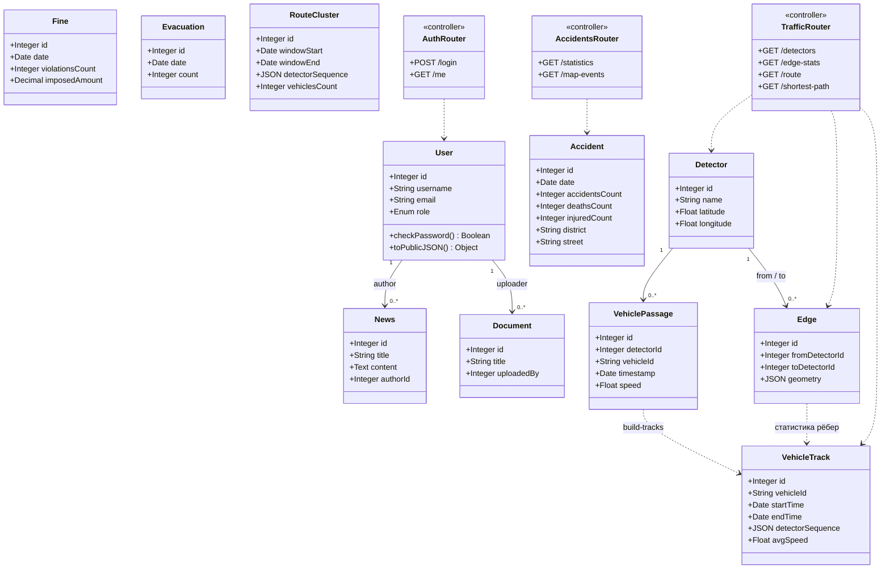
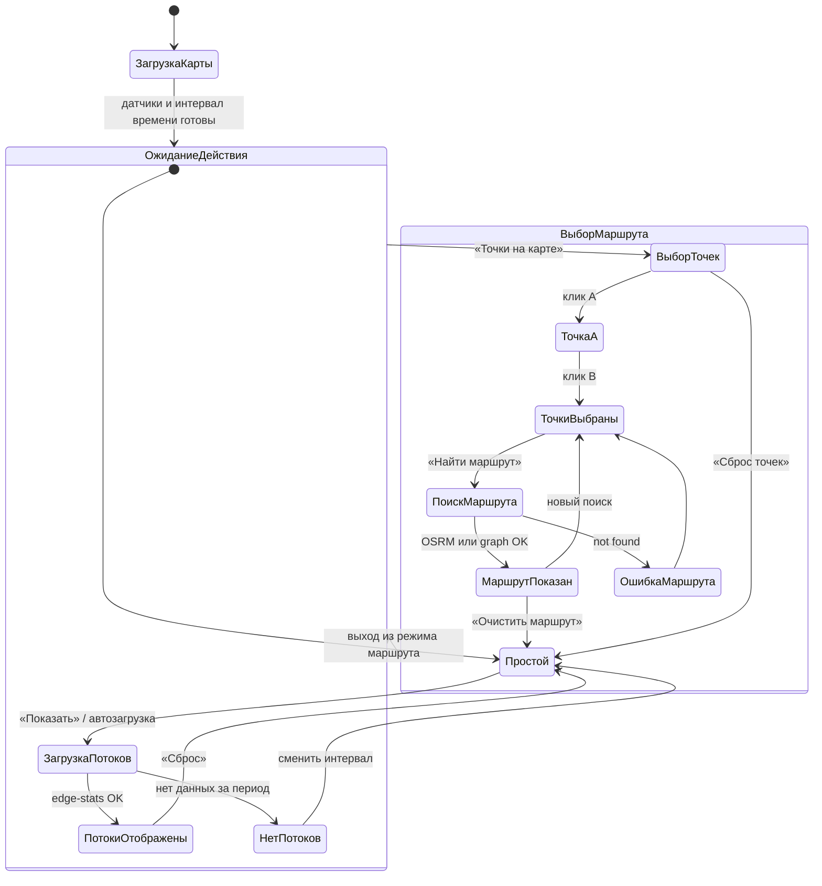

# FluxLane — UML (2 диаграммы)

## 1. Диаграмма классов

Доменные модели (Sequelize), связи и REST-контроллеры платформы.

---

## 2. Диаграмма состояний

Жизненный цикл страницы **«Карта и маршруты»** (`traffic-analysis.js`): потоки по датчикам и маршрут A→B.

---

*Файл проекта: `docs/UML-diagrams.md`*
